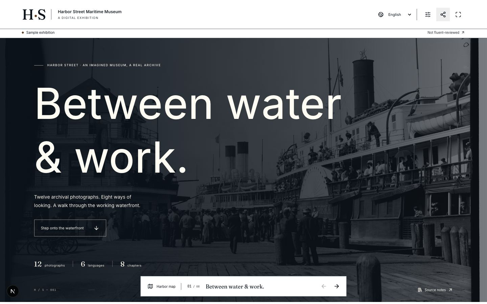

# Guild

Good work, together. A commission studio where producing agents work within a clear Passport, artifacts are checked against agreed contracts, and a curator decides what earns acceptance.

Harbor Street is a fictional maritime museum bringing twelve real archival photographs into a six-language exhibition. Sample content, actual model output, human review and payment receipts retain distinct provenance.

**[Open the exhibition](https://paypal-ai-guild.vercel.app/exhibitions/harbor-street)** · **[Open Guild](https://paypal-ai-guild.vercel.app)** · **[Read the submission story and short tour](SUBMISSION.md)**



*A previously captured curated sample reader, with its Sample and not fluent-reviewed labels preserved. The submission guide distinguishes the live release, actual production evidence and unfinished work.*

## Run locally

Use Node 22, npm and a dedicated PostgreSQL database. Copy `.env.example` to `.env`; configure the database and independent authentication, judge-session and worker secrets. Actual generation needs a server-side OpenAI key and available model names. The sample exhibition needs no model call.

```sh
npm ci
npm run db:migrate
npm run dev
```

Open http://localhost:4101. Judge entry creates an isolated eight-hour workspace. The review room can check, accept or request a correction to a sample artifact; sample acceptance never earns payment. The public [Harbor Street exhibition](http://localhost:4101/exhibitions/harbor-street) includes twelve actual Library of Congress photographs, eight chapter layouts, six locales, Arabic RTL, source notes, reading controls and a self-contained HTML export. It remains a labeled curated sample, with no accepted live artifacts, fluent-language review or audio recording claimed.

Generation and financial operations persist their work before dispatch. Run `npm run worker`, or schedule the authenticated `/api/jobs/recover` endpoint with `CRON_SECRET`. Use `npm run worker -- --production-only` to advance requested production without financial recovery. Workspace polling also advances already-requested production. These callbacks are a dispatch convenience, not a durable scheduler. Production persistence requires PostgreSQL. Set `APP_URL` to the exact HTTPS deployment origin before checkout; configure the registered `PAYPAL_WEBHOOK_ID` before webhook intake. The receiver registry and all credentials remain server-side.

## Verify

```sh
npm run typecheck
npm test
npm run test:integration
npm run build
node scripts/smoke-http.mjs
npm audit --omit=dev
```

Integration tests create disposable schemas in the configured dedicated PostgreSQL database and exercise the real APIMatic SDK and typed REST gateway against deterministic transport fixtures. They do not send money or invoke models. HTTP smoke requires the local server and configured isolated sandbox credentials for a Toolkit initialization check; that check makes no external request.

The native scheduling integration passes 60 domain/transport and 110 PostgreSQL tests, strict TypeScript, isolated production/QA builds and root-operated native review. Its [integration evidence](docs/evidence/scheduling/native-integration-qualification.json) separates synthetic AI transport, genuine native-engine/UI behavior and remaining actual-model/hosting gates.

The frozen 11 November 2026 narration follow-up checkpoint passes 57 domain/transport tests, 97 PostgreSQL/transport integration tests, a focused four-case follow-up lifecycle run, strict typechecking, the production build and isolated authenticated HTTP/native browser review. The [follow-up evidence](docs/evidence/production/narration-followup-implementation.json) records the synthetic scope and remaining actual-production gates. The [dependency review](docs/evidence/payments/dependency-review.md) retains the unresolved Toolkit advisories, narrow qualified override and actual loaded read path. A clean dependency audit is not claimed.

## Implemented behavior

Eight persisted studio views connect the commission, artifact dependencies, provider cards, a Passport booklet, contract/submission/check review, settlement, archive sources and evidence history. Commands are tenant-scoped, idempotent and revision-bound. Authority reservations are atomic; acceptance binds the artifact hash and contract version. A separate automated review records its actual limits. An explicit contract amendment and fresh Passport can permit downstream draft production from checked, automatically reviewed artifacts. The exact input hashes and review identities are retained; human acceptance and payment gates remain unchanged.

Brief compilation, research, translation and image descriptions use structured OpenAI Responses in background mode, with a saved response identity, short status reads, durable jobs and model-run provenance. Actual full research produced all 13 labels from the frozen 63-span source manifest in five batches, each carrying the complete collection context. All five deterministic checks passed. An attributed automated review inspected all 13 bodies and source-evidence panels; human acceptance remains open. Translation produces all 13 labels in five whole-collection target-language calls and retains the exact English original. An uncertain create is preserved for review and never automatically submitted again.

The image contract freezes full-frame WebP treatment, dimensions, file limits, rights and source hashes before production. Actual Sharp decoding, colour-profile checks and aligned pixel/perceptual comparisons qualify stored bytes. Six-language descriptions use the actual registered image as vision input. Private Blob objects have immutable identities, authenticated owned reads and independently verified hashes; unknown uploads are reconciled against the original path. The review UI compares source and derivative, exposes measurements and keeps historical-fidelity and fluent-language review open. The full commissioned image draft is complete: twelve actual vision calls, twelve photographs, twenty-four independently retrieved private files and five passed deterministic criteria. Maximum normalized RGB RMSE is 0.007501 and difference-hash distance is 2/64. A limited automated spot-review is recorded; human fidelity and acceptance remain open. See the [research evidence](docs/evidence/production/full-research.json), [image qualification](docs/evidence/media/image-pipeline-qualification.json) and [full image results](docs/evidence/production/full-images.json).

The commercial unit implements official PayPal checkout, authorization, acceptance-based captures, package-checkout fallback, explicit same-order return recovery, authorization closure, durable reconciliation, private provider payout operations, unclaimed-item cancellation and a persistent read-agent result. Money, recipients, final-capture selection and allowed resources are server-derived. Unknown writes retain their claims; a batch acknowledgement never counts as a paid provider. Only an independently checked matching payout item `SUCCESS` earns that status. Verified webhooks queue observations and reread owned resources; event payloads alone cannot change financial state.

Actual Guild sandbox qualification currently establishes one $640 authorization followed by a confirmed zero-capture void, and an actual model-selected `get_order` call through PayPal Agent Toolkit. Captures and provider payouts remain $0. The full $580 collection, $530 in six awards, partial/final-capture closure and authentic webhook delivery remain separate qualification gates. See the [payment contract](paypal-plan.md) and [safe evidence](docs/evidence/payments/commercial-execution-verification.json).

The full-language successor keeps the original translation, contract, checks and attributed review unchanged. Its proposed pack freezes exact English/keys, protected archival names, placeholders, language scripts/direction, independent `franc@6.2.0` identification, and blind Gemini back-translation. The real calibration selected `responseSchema` after five usable results out of five cases; the alternative transport produced zero usable results in ten retained attempts. Lexical scores remain advisory, with full comparisons and per-language calibration limits visible. The separately approved same-price successor completed all six full language files; its immutable production evidence is retained with the original draft and reviews. Human fluent review and acceptance remain separate gates.

Automated findings bind the exact artifact, contract and check report, so unrelated producer progress cannot invalidate that review. A genuine changed artifact or report still rejects the save, and the dialog preserves the written findings. Owned artifacts expose their original contracts, check reports and attributed reviews at `/api/artifacts/:id/evidence`.

The [publication room](docs/EXHIBITION_PUBLICATION.md) lets an active owner or judge prepare and deliberately publish an exact accepted exhibition with its five accepted source families. It binds the original files, source decisions and independent reports, retains immutable editions and makes older-link handling explicit. Public reads verify original bytes and honor withdrawal before ranges or ETags; withdrawal retains private originals and history. Operators inspect only. Publication dispatches no production, acceptance or payment work. Synthetic contract/HTTP fixtures and [root-operated native review](docs/PUBLICATION_NATIVE_PROTOCOL.md) retain separate evidence and do not assert actual human acceptance or fluent review.

Generated web production freezes the exact five-family source ancestry, bounded layout proposal and original authored reader. Formwork retains one original design; Ostrava retains its declared audit/repair sequence and original failures. Producer reports and independent byte/browser checks remain separate. Local and hosted adapters share durable single-dispatch case identities, original-result recovery and current-authority checks. The [composed integration](docs/WEB_COMPOSITION.md) has complete synthetic PostgreSQL workflows; actual current source eligibility, human acceptance and the remaining hosted accessibility finding retain their own gates.

Narration freezes every exact translated title/body and its language-specific duration estimate, then records one durable Realtime response per script. Original ordered chunks, provider IDs and completion receipts are retained before a final MP3 is published. Interrupted streams are preserved for review without reconnecting or creating a replacement. Independent verification decodes the actual private bytes, checks the agreed format/loudness/duration/transcript and retains a separate recognition result without the expected text in its prompt. A custom keyboard-accessible player exposes all recordings and scripts without autoplay; browser listening qualification remains open until actual commissioned recordings exist.

The [actual speech calibration](docs/evidence/media/narration-calibration.json) selected the full model after six measured cases passed; the two mini-model duration failures remain in the complete twelve-case denominator. No human listening or fluent review is inferred. Only the measured darwin/arm64 FFmpeg binary is qualified; a different deployment host requires its own native-engine evidence before new narration production. The full planned product remains in development.

The [targeted narration agreement](docs/NARRATION_TARGETED_CORRECTIONS.md) replaced five exact failed recordings while preserving 73 originals and all three earlier full submissions. Its actual independent report passes 77 of 78 recordings; one Arabic duration error remains 10.7563% against the unchanged 10% limit. That agreement is exhausted. The [separate one-recording follow-up](docs/NARRATION_FOLLOWUP_CORRECTIONS.md) requires a new exact note, reviewed cue and fresh Passport, preserves 77 segments with their true transitive producing origins, and retains the original authority deadline. Its distinct v4 artifact/report envelope allows one new stream and independently rechecks all 78 files. The separately approved original follow-up now passes all 78 deterministic file checks, with exactly one new stream and 77 unchanged recordings. Blind recognition meets its advisory target for 60 of 78; all 18 other results remain retained. The [original qualification](docs/evidence/production/narration-followup-original-qualification.json) includes the saved native automated review. Human listening, fluent acceptance and payment remain open.

The [original-audio caption contract](docs/CAPTIONS.md) now implements source-bound prompted timestamps, real-word cue partitioning, immutable VTT, six complete source-linked easy-read responses, independent byte-level verification and one separately approved included correction. Its [implementation qualification](docs/evidence/captions/implementation-qualification.json) records 81 passing domain tests, 125 broad integration tests, an additional complete 78-track/six-locale synthetic run and three root-operated native fixtures. Actual timestamp/easy-read provider qualification and human language review remain open. The old commission authority and original blind narration results remain unchanged.

## Integration status and remaining scope

- **PayPal/APIMatic:** immutable `@fracture/paypal-core@0.2.6`, generated `paypal@2.29.0` pinned to commit `5d0df8a8817e5fdf2e2cd48e68f790ea4730aab2`; typed REST handles Payouts because the pinned SDK has no Payouts controller. Toolkit 1.11.0 exposes only the qualified `get_order` path. Refund proposals/transport, recourse, invoicing and standing-wallet consent remain open.
- **Bryntum:** Gantt/Scheduler Enterprise 8 packages are installed. The production floor mounts Gantt and unified Scheduler over one native project, calculates working calendars/capacity/critical paths/baselines, retains revision-bound proposals and signs controlled recovery offers. Exact preparation requires a fresh Passport and preserves the original deadline. Native planning uses the validated read/compare/propose gateway. [Actual model qualification](docs/evidence/planner-live-qualification.json) retained eight responses, 26 known-ID reads, seven successful tools and one proposed $580 result while the active $540 schedule and approval stayed unchanged. Saved native history and safe formatting remain readable without provider credentials; hosted qualification remains open. Read [the scheduling contract](docs/SCHEDULING.md).
- **Storage:** PostgreSQL persists commissions, artifacts, authority, jobs, immutable contract amendments and reviews. Payout destinations and bodies are encrypted with row-bound authenticated encryption. Private Blob media transport is implemented; actual upload/read integrity is qualified locally. Hosted native-image and private-storage qualification remain open.
- **Production and protocols:** the full-language successor is complete in all six locales, with its original draft/checks/review retained under the earlier contract. Three full commissioned narration submissions and the targeted assembly remain unchanged with all original reports. The separately approved one-recording follow-up now passes 78/78 deterministic file checks; independent recognition remains advisory (60/78 meet its target). Listening and fluent acceptance remain open. Caption/easy-read implementation and isolated native review are qualified; actual provider output remains pending. Generated web source behavior and immutable publication are implemented with separately labeled synthetic qualification. The [provider-market source](docs/PROVIDER_MARKET.md) now connects bilateral owner policies, seven controlled addressed services, a tested A2A JSON-RPC profile and three bounded MCP tools. Full protocol conformance, production onboarding and external-provider interoperability retain separate gates. Actual eligible generated-web production, AP2-shaped signed exports, remaining acceptance packs, genuine Formwork evaluation, full accepted production and observed reputation remain required. HMAC receipts do not claim AP2 compliance or payer consent.
- **Release:** The [caption/exhibition source release](docs/CAPTION_WEB_HOSTED_RELEASE.md) is canonical on Vercel after a clean build, hosted Sample qualification, root native review and row/session preservation checks. The complete hosted media/provider/financial journey, full keyboard/768px/screen-reader/contrast/performance coverage, offline execution, studies and film remain open. Offline-file execution was blocked by the browser URL policy and is not claimed.

Keep `.env`, private plans and private qualification evidence out of Git. Judge cookies are HttpOnly/SameSite; browser mutations require the current origin. Reset preserves older commissions. The artifact viewer executes no arbitrary generated JavaScript or HTML.

The [capability ledger](docs/capabilities/guild.json) records chosen versions, prerequisites, observed evidence, fallbacks and product wording for every integration gate.

See [shared contracts](docs/CONTRACTS.md) and [the implementation handoff](docs/BUILD_HANDOFF.md) for exact boundaries and remaining work. Public setup does not require the ignored planning pack. This is a verified implementation unit within the complete planned product, which is still in development. The canonical release has an explicit Sample/source qualification boundary; it does not establish every planned provider, acceptance or financial outcome.

## Integrated exhibition source

Generated web production, immutable publication and original hosted recovery use additive migrations017–019. See [the integration contract](docs/WEB_COMPOSITION.md) and [the exact native review protocol](docs/COMPOSED_WEB_NATIVE_PROTOCOL.md). Synthetic source fixtures and actual runtime observations retain separate provenance; source tests do not grant acceptance, payment or publication authority.

Migration020 adds the [attributed caption review workflow](docs/DEEPGRAM_REVIEW_WORKFLOW.md). The [composed caption/exhibition contract](docs/CAPTION_WEB_COMPOSITION.md) binds the separately accepted correction edition into web production, independent checks, exact VTT downloads and immutable publication. Later drafts preserve the accepted edition and every original recognition result. Deepgram word timing and Gemini narration have separate provenance; automatic six-language alignment, human listening and fluent review keep their own qualification gates. Controlled composition checks use generated tones and explicitly fictional declarations, and do not establish native browser or actual-provider acceptance.

## License

Application code is MIT. APIMatic context retains its upstream license; see [APIMATIC_SETUP.md](APIMATIC_SETUP.md). Bryntum retains commercial/trial terms and requires the appropriate license. Each archival source preserves its actual Library of Congress rights advisory.

