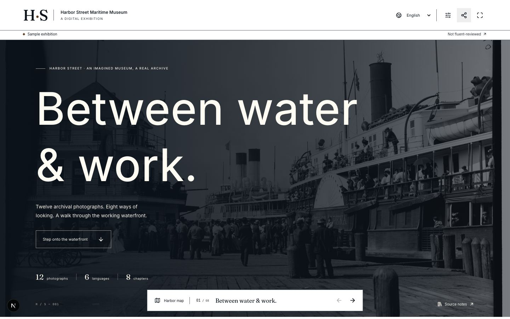

# Guild — good work, together

A small museum has extraordinary stories and a tiny team. Guild turns one exhibition brief into a coordinated studio—research, translation, imagery, narration and access—with a curator deciding what earns acceptance.

**[See the exhibition](https://paypal-ai-guild.vercel.app/exhibitions/harbor-street)** · **[Enter the commission studio](https://paypal-ai-guild.vercel.app)** · **[Run the source locally](README.md#run-locally)**

## The story

Harbor Street is an imagined maritime museum built around twelve real archival photographs. A curator wants visitors to meet the working waterfront in six languages, with accessible reading tools and clear source notes. The public exhibition makes that outcome tangible before asking anyone to understand an agent protocol.

Behind it, Guild treats each contribution as an agreement. A provider has a price and a scope. The curator can see the promised deliverable and its acceptance criteria. Passport limits what agents may do, for what purpose, within which budget and deadline. Research, translations, media and checks keep their original identities, so the reason for a decision remains inspectable.

The distinction matters when something goes wrong. A generated draft is work to review. An automated check is evidence. A curator's acceptance is a separate decision. A payment receipt records what PayPal actually did. Guild keeps these states connected without pretending they are interchangeable.

## A short tour

1. **Start with the outcome.** Open the exhibition, enter the waterfront and switch languages. Arabic changes the reading direction. Explore the source notes and reading controls. This is a clearly labelled curated sample.
2. **Meet the commission.** Open Guild and use its explicit sample entry. The work graph, provider cards and production floor explain how one brief becomes coordinated packages.
3. **Inspect the agreement.** Open Passport and a package's contract. Look at purpose, provider, cap, deadline and the criteria declared before acceptance.
4. **Follow the evidence.** Compare a source with its deliverable, then open the check and review history. Sample demonstrations and actual saved production results carry separate provenance.
5. **Close on accountability.** Inspect settlement and the payment evidence. The actual sandbox result is a $640 authorization followed by a confirmed void, with **$0 captured and $0 paid to providers**. A completed six-provider settlement is not claimed.

## What the evidence supports

| Mechanism | Demonstrated scope |
| --- | --- |
| PayPal and APIMatic | The pinned generated SDK supports the guarded payment path. Actual sandbox authorization and its zero-capture void are retained. A genuine model-selected `get_order` used PayPal Agent Toolkit. Payout implementation has controlled qualification; actual provider payouts remain zero. |
| AI production | Actual source-linked research, image derivatives and six-language translation files are retained. The original narration follow-up passes 78 of 78 deterministic file checks; independent recognition reaches its advisory target for 60 of 78. Human listening and fluent acceptance remain open. |
| Scheduling | The Bryntum production floor connects working calendars, dependencies, capacity and revision-bound recovery proposals. Native UI and actual planner evidence are documented separately. |
| Agent protocols | The provider market includes seven controlled addressed services, a tested A2A JSON-RPC profile and three bounded MCP tools. External-provider interoperability and full protocol conformance are not claimed. |

See the [payment evidence](docs/evidence/payments/commercial-execution-verification.json), [narration evidence](docs/evidence/production/narration-followup-original-qualification.json), [market contract](docs/PROVIDER_MARKET.md) and [capability ledger](docs/capabilities/guild.json).

## Release and presentation status

The submission candidate is the existing tested Vercel release at [paypal-ai-guild.vercel.app](https://paypal-ai-guild.vercel.app), product source `2aef34b00c7b09df89413b78f6ea656aa67f0bb4`. The homepage and public exhibition returned HTTP 200 during the 12 November 2026 UTC wind-up. This is a working prototype with a bounded Sample/source qualification, not a completed real museum commission.

Later local work on brief onboarding, recourse, Gemini speech, AP2 exports, saved wallets and provider packs is excluded from this canonical release. No new evaluation, financial exercise or production run was dispatched for the submission wind-up. The broader plan remains unfinished; there is no claim of real museum adoption, human study, fluent acceptance, a naturally failed-and-replaced Formwork commission or completed provider settlement.

The cover is an existing native capture with [provenance](docs/demo/ASSET_PROVENANCE.json). A written tour is ready; any video is identified separately by its final rendered artifact and validation. The older film scaffold is preparation material, not a completed demo.
